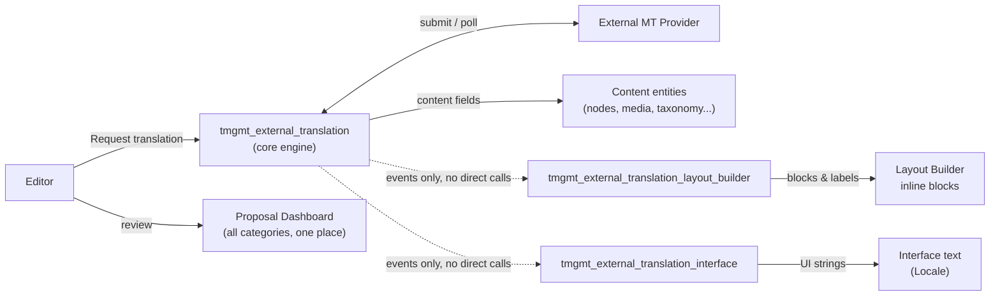

# External Translation — Documentation

This documents the external machine-translation system built on top of this Drupal 10 site: three custom modules that integrate an external MT provider with [TMGMT](https://www.drupal.org/project/tmgmt), Layout Builder, and Drupal's interface translation system — while making sure a machine translation can never silently overwrite a human's work, and never silently republishes moderated content.

## Start here, by role

| I am a... | Start with |
|---|---|
| Content editor / translator | [editorial-guide.md](editorial-guide.md) — how to request translations, what proposals mean, how draft review works, no code involved. |
| Developer extending or maintaining this system | [developer-guide.md](developer-guide.md) — service reference, extension points, testing. |
| Architect / technical lead evaluating the design | [architecture.md](architecture.md) — design principles, module boundaries, dependencies, sequence diagrams. |
| Deploying this to a site with existing content | [deployment-and-migration.md](deployment-and-migration.md) — required config, what happens to pre-existing content, storage impact. |

## All documents

- **[architecture.md](architecture.md)** — System overview, dependency graph (including `layout_builder_at` and `tmgmt`), design principles, module boundaries, the conflict/proposal decision model, moderation gating, the async submit/poll/complete lifecycle, and the full event catalog.
- **[data-model.md](data-model.md)** — The three database tables (`translation_provenance`, `translation_proposal`, `translation_pending_batch`), an ER diagram, and the provenance origin/status state machine.
- **[layout-builder-integration.md](layout-builder-integration.md)** — Deep dive on the largest subsystem: why blocks stay single-langcode forever, the shared-by-default model, fork-on-write, component labels, nested inline blocks, referenced-entity (Media) translation, and automatic staleness detection.
- **[interface-string-translation.md](interface-string-translation.md)** — How Drupal's interface/UI text translation reuses the same provenance and proposal engine, and how it differs from content translation.
- **[editorial-guide.md](editorial-guide.md)** — Plain-language guide for editors: requesting translations, resolving proposals, draft/publish behavior, shared Layout Builder blocks, troubleshooting.
- **[developer-guide.md](developer-guide.md)** — Service reference, the trackable-field-properties extension point, adding a real translation provider, State API tunables, permissions and routes, testing conventions, coding conventions.
- **[deployment-and-migration.md](deployment-and-migration.md)** — Required configuration on install, what happens to content that existed before this system was added, the Layout Builder backfill migration, and a storage impact estimate.
- **[glossary.md](glossary.md)** — Every domain-specific term used across these documents, in one place.

## System at a glance

For the full picture, start with [architecture.md](architecture.md).
