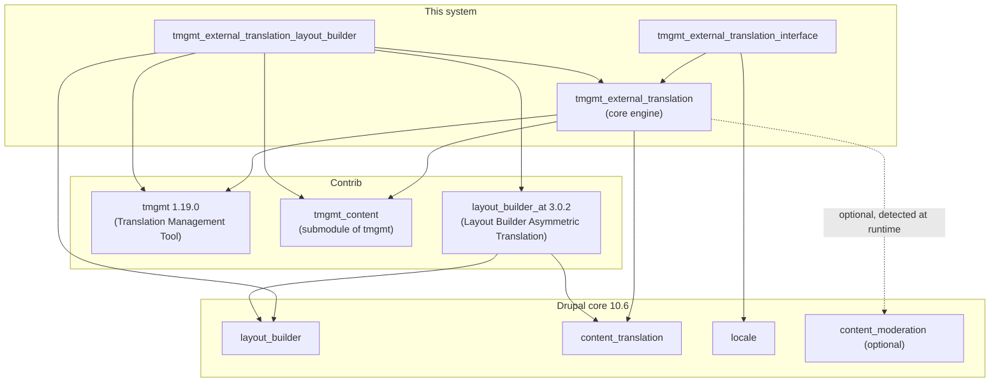
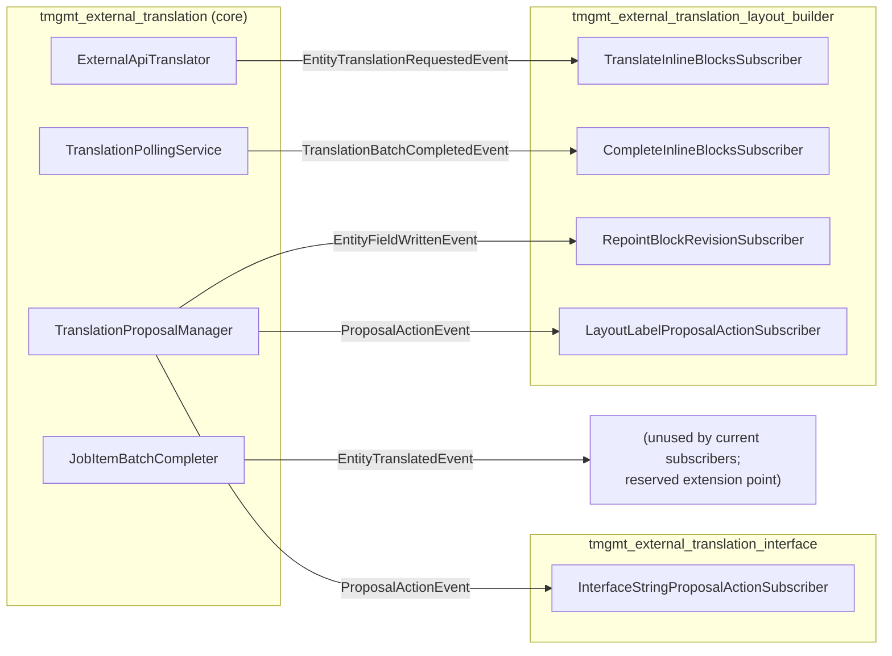
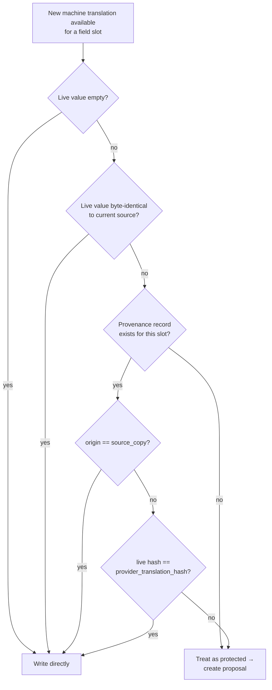
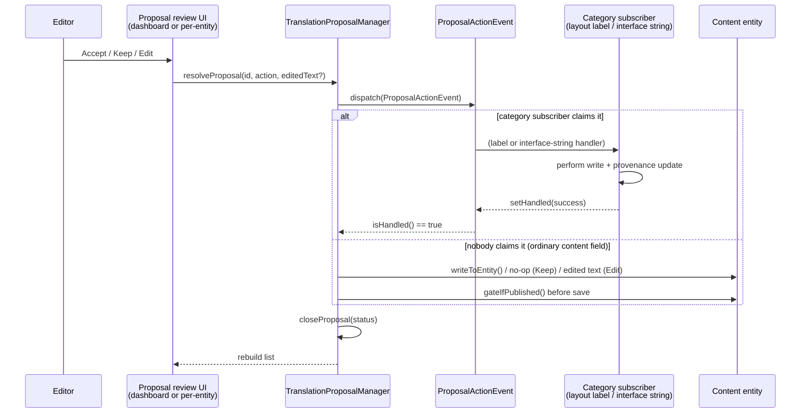
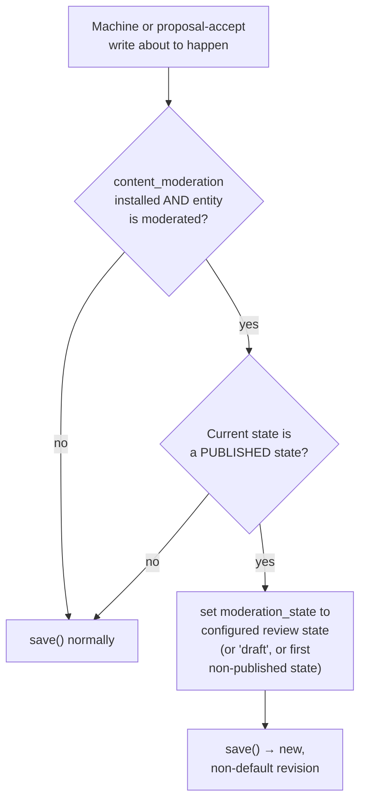
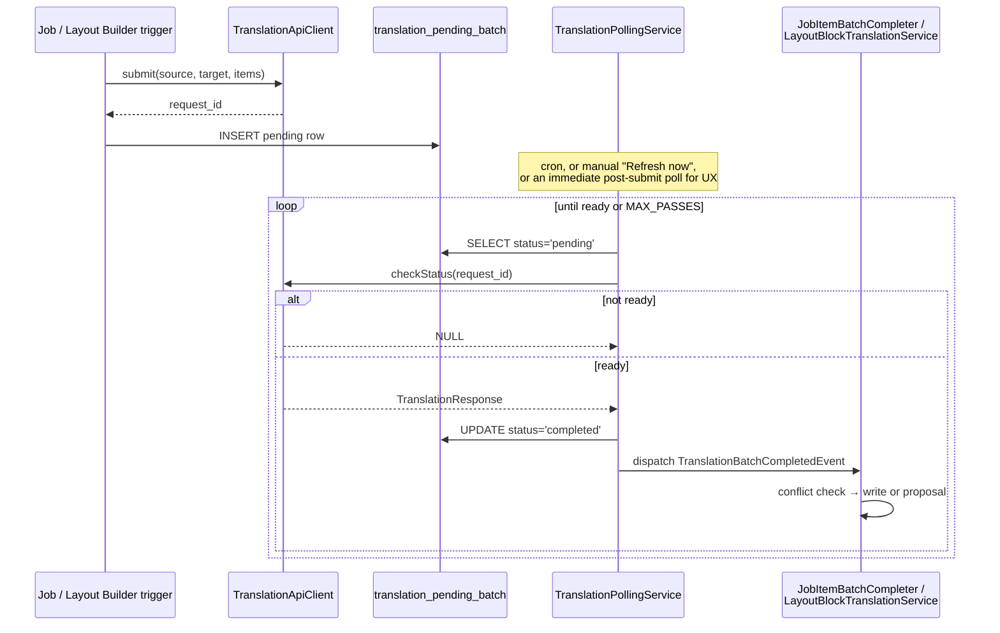

# Architecture

## What this system is

Three custom modules add external machine-translation support to a Drupal 10 site, on top of TMGMT (Translation Management Tool) for content, and integrated with Layout Builder for page-building blocks:

| Module | Responsibility |
|---|---|
| [`tmgmt_external_translation`](../web/modules/custom/tmgmt_external_translation) | Core engine: TMGMT translator plugin, provenance tracking, conflict detection, proposals, moderation gating, async submit/poll/complete. Depends on nothing else in this system. |
| [`tmgmt_external_translation_interface`](../web/modules/custom/tmgmt_external_translation_interface) | Extends the core engine to Drupal's interface strings (Locale UI translation). See [interface-string-translation.md](interface-string-translation.md). |
| [`tmgmt_external_translation_layout_builder`](../web/modules/custom/tmgmt_external_translation_layout_builder) | Extends the core engine to Layout Builder inline blocks (page-building content that isn't an ordinary translatable field). See [layout-builder-integration.md](layout-builder-integration.md). |

The two extension modules depend on the core module; **the core module depends on neither of them**. This is a deliberate, enforced boundary — see [Module boundaries](#module-boundaries) below.

## Dependencies

### `tmgmt` (contrib, `drupal/tmgmt: 1.19.0`)

The Translation Management Tool. Provides the job/job-item state machine (`ACTIVE` → `REVIEW` → `ACCEPTED`), the translator plugin architecture ([`ExternalApiTranslator`](../web/modules/custom/tmgmt_external_translation/src/Plugin/tmgmt/Translator/ExternalApiTranslator.php) is a `TranslatorPlugin`), and the `tmgmt_content` submodule's `ContentEntitySource` (how a job item's translatable data is extracted from and written back to a content entity — see [`tmgmt.data`](developer-guide.md#reused-tmgmt-services) service). This system rides on top of TMGMT's job orchestration rather than replacing it; the custom translator plugin is what plugs an external HTTP-style provider into that orchestration.

### `layout_builder_at` (contrib, `drupal/layout_builder_at: 3.0.2`)

**Required** for any Layout Builder translation support at all, and worth understanding precisely because two of its behaviors are load-bearing for this system, and one of its behaviors is deliberately worked around:

1. **Forces `layout_builder__layout` translatable.** Its own `layout_builder_at_field_storage_config_presave()` hook sets the field storage's `translatable` flag to `TRUE` wherever the field exists, entity-type-agnostically — including on `block_content` bundles, which is what makes **nested inline blocks** possible (a block having its own Layout Builder layout). Without this module, a node's layout override field is not translatable at all, and every language would render byte-identical layout content (see [deployment-and-migration.md](deployment-and-migration.md#what-happens-to-pre-existing-content) for what this means for a site adopting it after already having multilingual content).
2. **Provides the per-translation override mechanism.** Each translation gets its own independently-stored Section/component array once the field is translatable — this system's [shared-by-default model](layout-builder-integration.md#shared-by-default) builds directly on top of that per-translation storage, it doesn't replace it.
3. **Ships a "Copy blocks into translation" checkbox** on the standard "Add translation" form, which — left *unchecked* — leaves the new translation's layout field completely empty (confirmed via direct source read: `LayoutBuilderCopyWidget::extractFormValues()`'s unchecked branch calls `$items->setValue(NULL)`). This system adds its own `hook_entity_presave()` ([`tmgmt_external_translation_layout_builder.module`](../web/modules/custom/tmgmt_external_translation_layout_builder/tmgmt_external_translation_layout_builder.module)) that runs *after* the widget either way and restores an empty new-translation layout field from the source's current value — making "shared, not empty" the real default, while the checkbox remains available as an opt-in eager-duplication escape hatch. See [layout-builder-integration.md](layout-builder-integration.md#shared-by-default) for the full mechanics.

### Drupal core modules

- **`content_translation`** — the core content-translation system this whole engine writes into and reads provenance against. Required (enabled automatically as a dependency of both `tmgmt_external_translation` and `layout_builder_at`).
- **`layout_builder`** — required only by the layout-builder submodule.
- **`locale`** — required only by the interface-string submodule.
- **`content_moderation`** — **optional**, detected at runtime. [`ModerationGate`](../web/modules/custom/tmgmt_external_translation/src/Translation/ModerationGate.php) is constructor-injected with `@?content_moderation.moderation_information` (Symfony's `@?` — resolves to `NULL` rather than erroring if the service doesn't exist) and checks `moduleHandler->moduleExists('content_moderation')` before doing anything. On a site without content moderation, every machine/proposal write simply goes straight to the entity's normal default revision, with no gating. If the site later adds moderation, no code change is needed — the gate activates automatically for whichever bundles have a workflow attached, per the existing `tmgmt_content.settings:default_moderation_states` config (see [Moderation gating](#moderation-gating)).

### Provider dependency

None, structurally. [`TranslationApiClientInterface`](../web/modules/custom/tmgmt_external_translation/src/Client/TranslationApiClientInterface.php) is the only contract the rest of the system depends on; the POC ships [`MockTranslationApiClient`](../web/modules/custom/tmgmt_external_translation/src/Client/MockTranslationApiClient.php) (deterministic, no network calls, simulates async delay via State API). Swapping in a real vendor is a service alias change — see [developer-guide.md](developer-guide.md#adding-a-real-translation-provider).

## Design principles

1. **Never silently overwrite protected content.** Every write path checks conflict status first; anything that can't be proven safe becomes a **proposal**, not an overwrite. See [The conflict / proposal model](#the-conflict--proposal-model).
2. **Never silently republish.** A write to a currently-published, moderated entity is redirected into a draft (or configured review) revision. See [Moderation gating](#moderation-gating).
3. **Never assume the provider responds instantly.** Every translation request is submit-now/poll-later, modeled after a real HTTP API, not a same-request round trip. See [Async lifecycle](#async-lifecycle-submit--poll--complete).
4. **The core module knows nothing about its extensions.** Layout Builder and interface-string support are bolted on entirely through events; deleting either submodule doesn't touch the core module's code. See [Module boundaries](#module-boundaries).
5. **Field-type support is an explicit allow-list, not a heuristic.** See [developer-guide.md](developer-guide.md#trackable-field-properties).

## Module boundaries

The core module dispatches five events and reacts to none of the submodules' internals; each submodule subscribes to whichever events it needs and never gets called into directly by core code.

### Event catalog

| Event | Dispatched by | Purpose | Subscribed by |
|---|---|---|---|
| `EntityTranslationRequestedEvent` | `ExternalApiTranslator::requestJobItemsTranslation()` | A host entity's ordinary fields were just *submitted* (not yet translated) for MT. | `TranslateInlineBlocksSubscriber` — submits the host's Layout Builder blocks/labels concurrently, not waiting for the host's own fields to finish. |
| `EntityTranslatedEvent` | `JobItemBatchCompleter::complete()` | A host entity's ordinary fields finished processing (translated or diverted to proposals). | No current subscriber — reserved extension point (was the pre-async trigger for block translation; superseded by the submit-time event above for better concurrency). |
| `TranslationBatchCompletedEvent` | `TranslationPollingService::processOnePass()` | An async batch (`translation_pending_batch` row) is ready. | `CompleteJobItemBatchSubscriber` (core, `kind=job_item`) and `CompleteInlineBlocksSubscriber` (layout_builder, `kind=layout_inline_blocks`) — each claims only its own kind. |
| `EntityFieldWrittenEvent` | `TranslationProposalManager::writeToEntity()` | A proposal Accept/Edit just wrote directly to an entity field, creating a new revision. | `RepointBlockRevisionSubscriber` — if the written entity is a `block_content` used as an inline block, repoints the layout component that references it to the new revision. |
| `ProposalActionEvent` | `TranslationProposalManager::resolveProposal()` | About to resolve a proposal (Accept/Reject/Edit) — a chance for a non-entity-field target to claim it. | `LayoutLabelProposalActionSubscriber` (claims `field_name === 'layout_component_label'`) and `InterfaceStringProposalActionSubscriber` (claims `target_entity_type === 'interface_string'`). If neither claims it (`isHandled() === FALSE`), `resolveProposal()` falls back to its own generic entity-field write. |

This is a **mutable event** pattern for `ProposalActionEvent` specifically: subscribers call `$event->setHandled($success)`, and the dispatcher checks `isHandled()` afterward to decide whether to run its own fallback logic. It's the mechanism that lets `resolveProposal()` be the single entry point for every proposal category (content field, interface string, layout label) without an `if/elseif` chain of category checks living in the core module.

## The conflict / proposal model

Every write path — ordinary field translation, Layout Builder block translation, interface strings — runs the same decision before writing:

`W` (write directly) also records the new provenance baseline (`recordMachineTranslation`). `P` (proposal) creates a `translation_proposal` row and leaves the live value completely untouched — see [`TranslationConflictDetector`](../web/modules/custom/tmgmt_external_translation/src/Translation/TranslationConflictDetector.php) for the authoritative implementation (`hasEditorModification()` / `hasEditorModificationForValue()`).

### Resolving a proposal

Two review surfaces call the same `resolveProposal()` entry point: the site-wide [`ProposalDashboardForm`](../web/modules/custom/tmgmt_external_translation/src/Form/ProposalDashboardForm.php) (`/admin/content/translation-proposals`) and the per-entity [`EntityTranslationStatusForm`](../web/modules/custom/tmgmt_external_translation/src/Form/EntityTranslationStatusForm.php) (`/node/{node}/translations`), sharing their row-rendering logic via [`ProposalReviewElementsTrait`](../web/modules/custom/tmgmt_external_translation/src/Form/ProposalReviewElementsTrait.php).

## Moderation gating

If `content_moderation` is installed and the target entity's bundle is under a workflow, any write that would otherwise land on a **currently-published** revision is redirected: [`ModerationGate::gateIfPublished()`](../web/modules/custom/tmgmt_external_translation/src/Translation/ModerationGate.php) sets `moderation_state` to the workflow's configured review state (`tmgmt_content.settings:default_moderation_states.{workflow}` — the *same* config TMGMT's own content source already reads, so there's one admin-configurable setting for every write path in the system, not a second independent default) before the entity saves. Falls back to `draft` if configured, or the workflow's first non-published state if `draft` doesn't exist.

Called from every write path that can touch a moderated entity: `TranslationProposalManager::writeToEntity()`, `LayoutEntityCollector::setComponentLabel()`/`repointComponent()`, and `TranslationEntityWriter::write()` (the generic referenced-entity writer). `JobItemBatchCompleter` writes through TMGMT's own `ContentEntitySource::saveTranslation()`, which already reads the same config independently — no duplicate gating needed there.

**Practical effect:** the site's live/default revision never changes as a direct result of machine translation. An editor sees the translated text on the entity's "Latest version" preview and reviews it there before it ever reaches the published version — see [editorial-guide.md](editorial-guide.md#draft-behavior-for-published-content).

## Async lifecycle: submit → poll → complete

`TranslationPollingService::processAllPending()` loops passes as long as the previous pass completed at least one batch (capped at `MAX_PASSES = 20` as a runaway safety net) — this lets a cascade of instantly-ready completions (e.g. the mock client's default `ready_after_checks = 1`) all resolve within a single call, while genuinely still-pending batches correctly wait for a later call instead of spinning.

Every UI action that requests translation (the "Request translation" button, the "Also request machine translation" checkbox, node's `hook_cron()`) calls `processAllPending()` once immediately after submitting, so the mock provider's default configuration *feels* synchronous even though the underlying mechanism is fully async — a real provider that takes real time degrades gracefully to "translated a bit later, once cron runs or Refresh now is clicked," with zero code path changes.

## Where to go next

- [data-model.md](data-model.md) — the three tables this architecture is built on, in detail.
- [layout-builder-integration.md](layout-builder-integration.md) — the largest and most novel extension: shared-by-default blocks, fork-on-write, nested blocks, staleness detection.
- [interface-string-translation.md](interface-string-translation.md) — the smaller extension module.
- [developer-guide.md](developer-guide.md) — service reference, extension points, testing.
- [editorial-guide.md](editorial-guide.md) — what all of this looks like from an editor's chair.
- [deployment-and-migration.md](deployment-and-migration.md) — installing this on a site with existing content.
