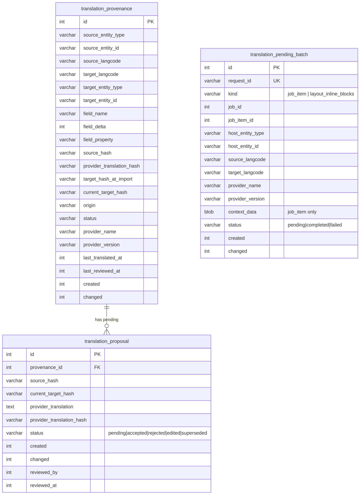
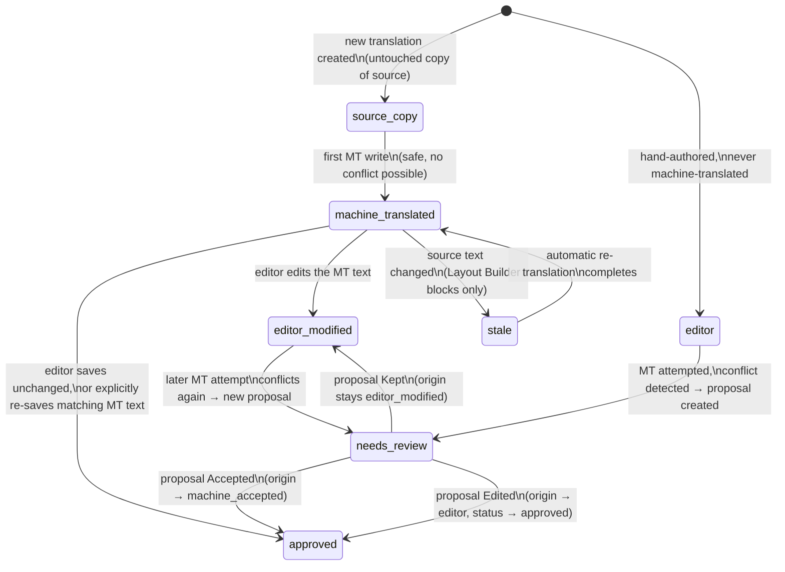
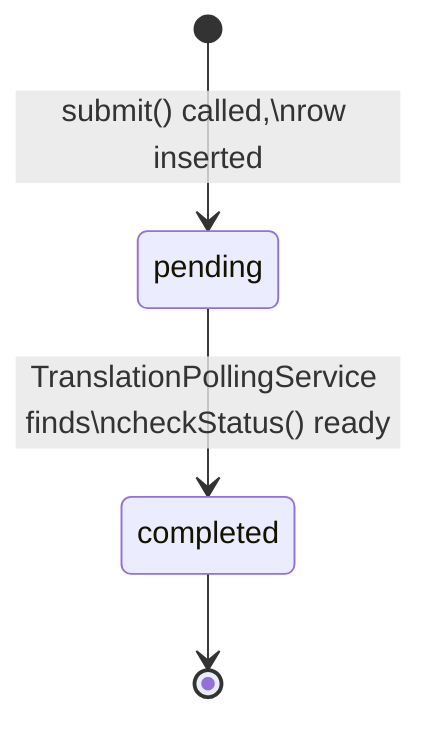

# Data Model

Three plain SQL tables — not entities — hold all of this system's bookkeeping. They're deliberately outside Drupal's Entity API: this is metadata about translations (hashes, origin, status, async request state), not user-facing content, so the overhead of full entity storage isn't warranted. All three live in [`tmgmt_external_translation.install`](../web/modules/custom/tmgmt_external_translation/tmgmt_external_translation.install).

See [glossary.md](glossary.md) for term definitions used below.

## Entity-relationship overview

`translation_pending_batch` is intentionally **not** linked to the other two tables by a foreign key — it tracks in-flight *requests* to the provider, which are resolved into provenance/proposal rows only once a batch completes (see [architecture.md](architecture.md#async-lifecycle-submit--poll--complete)).

## `translation_provenance`

The core table. One row = one **field slot** ([glossary](glossary.md#field-slot)): a specific property, delta, field, entity, and language. The unique key `target_slot` (`target_entity_type`, `target_entity_id`, `target_langcode`, `field_name`, `field_delta`, `field_property`) enforces this — there is never more than one live row per slot; every write is an upsert.

| Column | Purpose |
|---|---|
| `source_entity_type` / `source_entity_id` / `source_langcode` | Where the source text came from. Usually the same entity as the target (just a different language), except Layout Builder's referenced-entity following, where a block is the source and a Media item is the target. |
| `target_entity_type` / `target_entity_id` / `target_langcode` | What this slot's value lives on. |
| `field_name` / `field_delta` / `field_property` | Which field slot. `field_name` is sometimes a pseudo-name — `layout_component_label` for a Layout Builder heading, or the literal `lid` for interface strings — not always a real Drupal field name. |
| `source_hash` | Hash of the source text *as of the last translation*. Compared against the *current* source at staleness-check time. |
| `provider_translation_hash` | Hash of the last text the provider actually returned. This is the baseline a live value is compared against to detect an editor edit. |
| `target_hash_at_import` | Hash of the target value at the moment the provider translation was first imported. Currently written but not read elsewhere — reserved for a future "what changed since import" diff view. |
| `current_target_hash` | Hash of the field's live value, kept in sync by every write path (machine translation, editor save, proposal resolution). Comparing this against `provider_translation_hash` is how [`TranslationProvenanceManager::isEditorModified()`](../web/modules/custom/tmgmt_external_translation/src/Translation/TranslationProvenanceManager.php) works. |
| `origin` | See [glossary](glossary.md#origin). |
| `status` | See [glossary](glossary.md#status). |
| `provider_name` / `provider_version` | Which provider produced the last machine translation, for audit. |
| `last_translated_at` / `last_reviewed_at` | Timestamps for the two kinds of activity on this slot. |

### Origin/status state machine

`copied_from_source` (status) always pairs with `origin = source_copy` and is a terminal-ish state only in the sense that nothing *needs* to happen to it — the first successful machine translation naturally transitions it to `machine_translated`.

## `translation_proposal`

One row per **pending decision**. `provenance_id` links back to the field slot this proposal is about — `provider_translation` holds the full proposed text (nullable, so storage can be disabled for privacy-sensitive deployments), and `status` tracks its own independent lifecycle (`pending` → `accepted` / `rejected` / `edited`; `superseded` is reserved for a case where a newer proposal replaces an unresolved older one for the same slot, though the current code actually *updates the existing pending row in place* rather than creating a superseding one — see [`TranslationProposalManager::createProposal()`](../web/modules/custom/tmgmt_external_translation/src/Translation/TranslationProposalManager.php)).

Both `source_hash` and `current_target_hash` are snapshotted at proposal-creation time (not read live from `translation_provenance`), so the proposal review UI can show a stable comparison even if the live value changes again before the proposal is resolved.

## `translation_pending_batch`

Tracks one outstanding request to the provider between `submit()` and a poll finding it ready. See [architecture.md](architecture.md#async-lifecycle-submit--poll--complete) for the full lifecycle.

| Column | Purpose |
|---|---|
| `request_id` | Opaque id returned by [`TranslationApiClientInterface::submit()`](../web/modules/custom/tmgmt_external_translation/src/Client/TranslationApiClientInterface.php). Unique — this is the poll key. |
| `kind` | `job_item` (an ordinary TMGMT job item's fields) or `layout_inline_blocks` (a host entity's Layout Builder blocks/labels). |
| `job_id` / `job_item_id` | Set for `kind = job_item` only. |
| `host_entity_type` / `host_entity_id` | Set for `kind = layout_inline_blocks` only — the node (or other host) whose Layout Builder override triggered the batch. |
| `context_data` | JSON blob of `{items, contexts}` for `kind = job_item` — needed to re-run the per-field conflict/write/proposal logic once the batch completes, since the request/response round-trip can span separate PHP processes. **Always NULL for `kind = layout_inline_blocks`** — block pairs are cheaply re-derived fresh from the host entity at completion time instead of frozen at submit time, which is actually more correct (it reads whatever the blocks currently look like, not a stale snapshot). |
| `status` | `pending` → `completed` (or `failed`, not currently set by any code path — reserved for a real provider's error responses). |

### Pending batch lifecycle

Two independent producers can insert a `pending` row: [`ExternalApiTranslator::requestJobItemsTranslation()`](../web/modules/custom/tmgmt_external_translation/src/Plugin/tmgmt/Translator/ExternalApiTranslator.php) for `job_item`, and [`LayoutBlockTranslationService::submitInlineBlocks()`](../web/modules/custom/tmgmt_external_translation_layout_builder/src/Layout/LayoutBlockTranslationService.php) for `layout_inline_blocks` — both triggered off the same [`EntityTranslationRequestedEvent`](architecture.md#event-catalog), fired once per translation request, so both batches submit concurrently rather than one waiting on the other.

## Why plain SQL tables, not entities

- No user-facing UI needs to be generated for free (no entity forms, no Views integration expected) — every read/write goes through a purpose-built service method.
- Hash comparison and upsert-by-unique-key are naturally SQL operations; an entity API round-trip would add overhead with no benefit here.
- Keeps this bookkeeping data type-agnostic: a "field slot" can point at a node field, a `block_content` field, a Layout Builder component label, or an interface string `lid` — none of which are the same kind of Drupal object, so no single entity bundle could model all four naturally.
