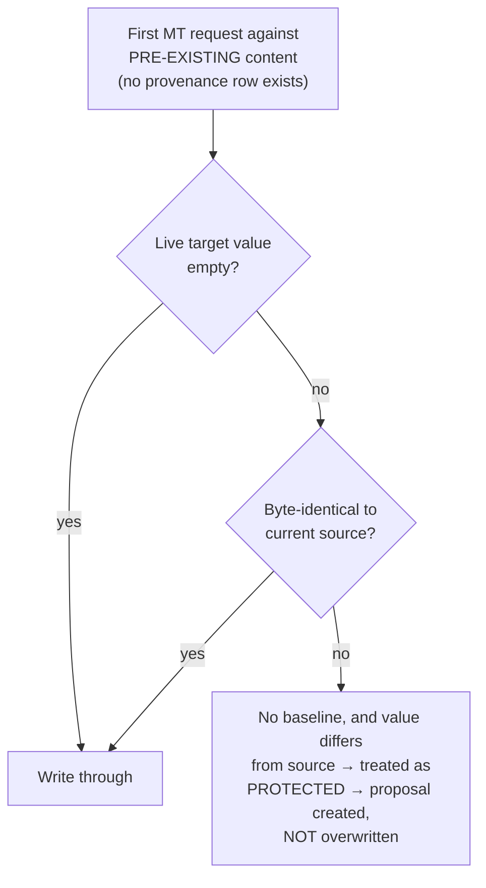
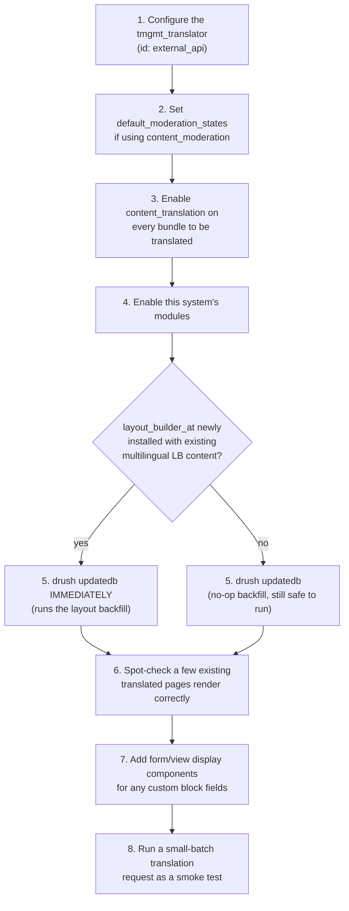

# Deployment & Migration

What to do when installing this system on a site that **already has content, translations, and Layout Builder usage** — as opposed to a fresh site built with it from day one. All findings below were verified empirically against a live database, not assumed.

## Prerequisites

See [architecture.md](architecture.md#dependencies) for full dependency detail. In short: `content_translation` (core), `layout_builder` + `layout_builder_at` 3.0.2 (only if using the Layout Builder module), `locale` (only if using the interface-string module), `tmgmt` 1.19.0 + `tmgmt_content`. `content_moderation` is optional and auto-detected.

## Required configuration after enabling

None of these are automatic on module install — set them explicitly:

1. **Configure a translator.** Create a `tmgmt_translator` entity with id `external_api` (the id every service in this system looks up by). Without it, the "Also request machine translation" checkbox never renders and `TranslationRequestHelper` fails gracefully with a warning message rather than a fatal error.
2. **Set the moderation review state**, if using `content_moderation`:
   ```
   drush config:set tmgmt_content.settings default_moderation_states.<workflow_id> draft
   ```
   This one config key controls every write path in the system (TMGMT's own job-item writes, and this system's `ModerationGate`) — see [architecture.md](architecture.md#moderation-gating). Without it, the gate still activates (falls back to `draft` if that state exists, or the workflow's first non-published state) — but setting it explicitly is recommended for predictability.
3. **Enable `content_translation` on every bundle that should be translatable** — standard Drupal configuration, not something this system does for you. For Layout Builder blocks specifically, `layout_builder_at`'s own install hook forces the **field storage** translatable automatically; the **field config** (bundle-level) translatable flag on `layout_builder__layout` may still need to be set explicitly per bundle if it wasn't already — confirmed as a real gap during this project's own build-out (`block_content:basic` needed both flags set manually).
4. **Add form/view display components for any custom fields** this system will translate (e.g. a `field_media_ref` entity reference on a block bundle) — ordinary Drupal display configuration, easy to forget when a field was added programmatically rather than through the UI.

## What happens to pre-existing content

### Ordinary translatable fields — safe by construction, no migration needed

[`TranslationConflictDetector::hasEditorModificationForValue()`](../web/modules/custom/tmgmt_external_translation/src/Translation/TranslationConflictDetector.php) makes no assumption that a provenance record exists yet:



Content genuinely translated by a human before this system existed is automatically safe: a translation request against it creates a review proposal instead of silently overwriting real work. **Verified, not assumed** — this is unconditional logic in the conflict detector, requiring no backfill or seeding step.

### Layout Builder layouts — one real gap, fixed by an update hook

**If `layout_builder_at` wasn't previously installed** (the common case — it's usually adopted specifically *for* this project), the `layout_builder__layout` field was **not translatable** before. Confirmed empirically: with the field non-translatable, every language reads the same single shared value automatically (there's nothing to migrate — this is actually the *best possible* starting state, equivalent to what this system's own "shared by default" model produces intentionally). But the moment `layout_builder_at` is installed and forces the field storage translatable — **with no resave in between** — every non-default-language translation's layout field reads back **empty**:

```
Simulated OLD system: field translatable now                     : FALSE
FR layout field while still non-translatable (expected: mirrors EN): populated
Field translatable now (after simulated module install)          : TRUE
FR layout field immediately after flag flip, no resave (the real question): EMPTY
```

(Reproduced directly against this project's own database — a node was built with a shared, non-translatable layout field, then the field was flipped translatable exactly as `layout_builder_at`'s install hook does, with no resave in between.) This is not a maybe — it is the guaranteed, immediate consequence of installing `layout_builder_at` on a site with existing multilingual Layout Builder content.

**The fix:** [`tmgmt_external_translation_layout_builder_update_10001()`](../web/modules/custom/tmgmt_external_translation_layout_builder/tmgmt_external_translation_layout_builder.install) — a batched `hook_update_N()` that finds every existing, already-saved (not just newly-added) translation with an empty layout field, and backfills it from its source translation's current value. Same restore-on-empty logic as the live [`entity_presave()`](../web/modules/custom/tmgmt_external_translation_layout_builder/tmgmt_external_translation_layout_builder.module) hook (see [layout-builder-integration.md](layout-builder-integration.md#shared-by-default)), just applied retroactively and in bulk instead of only on a future save.

**Run this immediately after enabling `layout_builder_at`** (`drush updatedb`), not as a later cleanup step — real pages will render with empty Layout Builder content in every non-default language until it runs. Verified end-to-end in [`scripts/phase16_backfill_test.php`](../scripts/phase16_backfill_test.php): simulates a legacy-empty translation, runs the update hook, confirms the translation is restored to reference the same blocks as the source, and confirms a subsequent machine translation on the backfilled block works correctly while the source language's own component stays completely untouched.

### What's *not* affected

- **Reusable content entities** referenced by blocks (Media, taxonomy terms) — ordinary translatable fields, covered by the same safe-by-construction logic above.
- **`inline_block_usage`** — core-managed, unaffected by any of this.
- **Already-forked, per-language-distinct Layout Builder content** (e.g. a site that already used eager block duplication by some other means) — the block mapper matches by id first, falls back to positional pairing, so distinct pre-existing block ids per language are handled natively, no migration needed.

### Known, unsolved limitation for already-forked content

If a translation's layout was already forked *before* this system's own fork-on-write model existed (its own genuinely independent layout, not sharing anything with the source), there is **no retroactive re-sync**: a block added to the source language afterward will not automatically appear in that already-diverged translation. This is the same "no sync mechanism" limitation that applies to any forked layout under the current design, migration or not — not something the backfill update hook can or should attempt to fix (forcibly re-sharing already-intentionally-diverged content would be destructive, not a migration).

## Storage impact estimate

Ballpark for a representative migration scenario — **100,000 nodes, 5 languages (1 source + 4 translations needing backfill), 5–10 Layout Builder blocks per node**, using real per-row sizes measured against this project's own database:

| Component | Basis | Volume | Estimate |
|---|---|---|---|
| Backfilled layout field rows | ~700 bytes (1 block) to ~2.7 KB (multi-block) measured; scaled to 5–10 blocks | 100,000 × 4 = 400,000 new rows | **~0.6–1 GB** |
| One extra revision per node (moderation forces a new revision on save) | Full snapshot of title+body+layout across all 5 languages; body size is the dominant unknown | 100,000 revisions | **~1.5–3 GB** |
| Provenance baseline rows (side effect of the resave, title+body) | ~500–975 bytes/row measured | 100,000 × 4 langs × 2 fields = 800,000 rows | **~0.4–0.8 GB** |
| **Total** | | | **~2.5–5 GB, one-time** |

**What keeps this from being much larger:** `block_content` entities themselves are never duplicated by this migration — only *referenced*. If a site instead used eager block duplication (a real new `block_content` entity + revision per block per language), the same 100,000-node/5-language/5–10-block scenario could easily reach tens of GB, dominated by actual block body/media content multiplied across languages. This migration avoids that scaling entirely.

**Biggest lever on the real number:** average body/WYSIWYG field size — the dominant, most site-specific variable in the "one extra revision" line. Check your site's actual average node size before committing to a large-scale rollout; the estimate above assumes a modest 2–4 KB body.

## Rollout checklist



## See also

- [layout-builder-integration.md](layout-builder-integration.md) — why the shared-by-default model works the way it does.
- [data-model.md](data-model.md) — the tables this migration populates.
- [developer-guide.md](developer-guide.md#testing) — running `scripts/phase16_backfill_test.php` and the rest of the regression suite.
