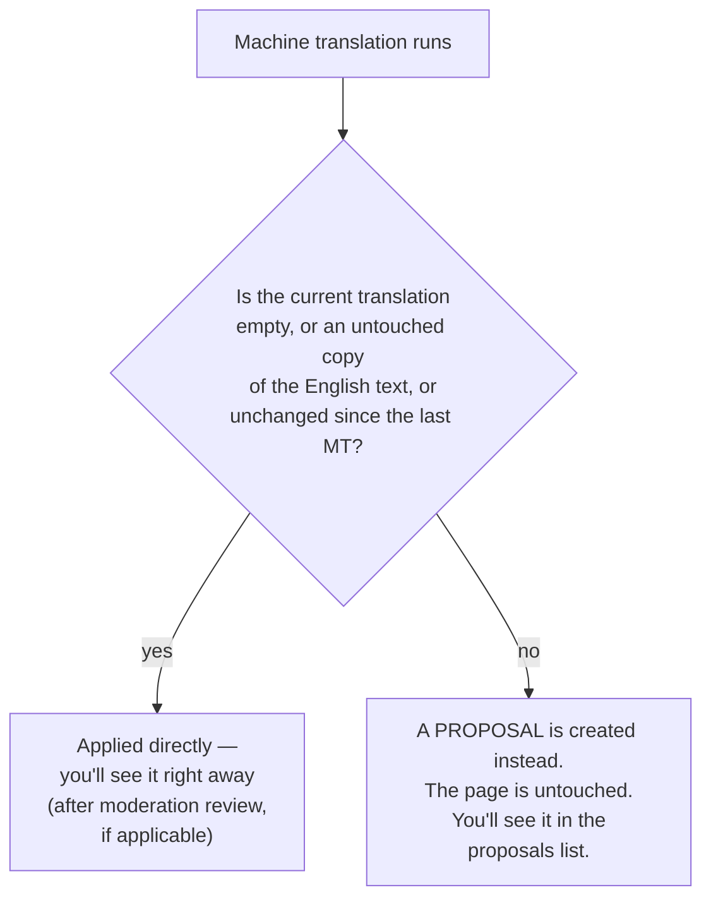
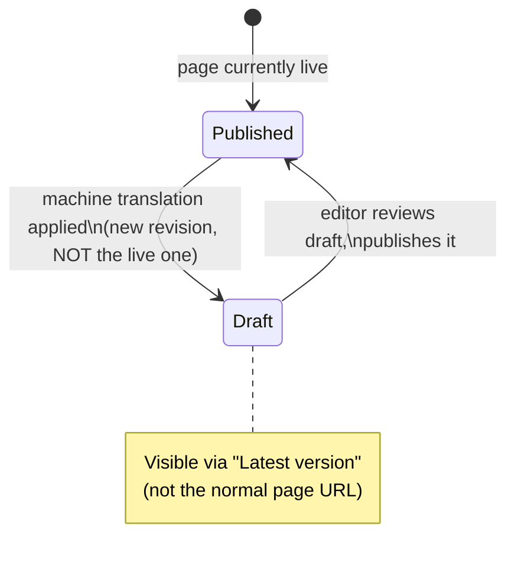

# Editorial Guide

For content editors and translators using machine translation on this site. No code in this document — for the technical design behind any of this, see [architecture.md](architecture.md).

## Requesting a translation

Two ways to trigger machine translation, depending on what you're doing:

**Adding a brand-new translation.** On the "Add translation" form for any translatable content, check **"Also request machine translation"** before saving. The page saves normally, and machine translation is requested automatically right after — you don't need a separate step.

**An existing translation you want to (re-)translate.** Go to the content's **Translate** tab (`/node/{id}/translations`). Select the target language(s) and click **Request translation**.

Either way, if the content has Layout Builder blocks on the page, those are translated automatically in the same action — you don't request block translation separately.

## Where to check progress

Every translatable page has a **"Machine translation status"** section on its Translate tab, showing:
- Recent translation requests for this content (its own fields, and its Layout Builder blocks, tracked separately) and whether each is still waiting on the provider or has completed.
- A **"Refresh now"** button — checks the provider for anything still outstanding and applies results that are ready. (This also happens automatically in the background; "Refresh now" just doesn't make you wait for the next automatic check.)

For a site-wide view instead of one page at a time, use the **Translation proposals** dashboard under Content administration — covered next.

## Understanding proposals

Machine translation **never silently overwrites a translation someone already worked on.** If the system can't be sure the current text is safe to replace, it creates a **proposal** instead — the new machine translation sits pending review, and the page keeps showing whatever it showed before.

In practice, this means: the *first* time you machine-translate something, it always applies directly. A proposal only shows up when you (or someone else) already touched that specific piece of translated text by hand, and a *new* machine translation later disagrees with it — the system is protecting your prior edit.

### Resolving a proposal

Find pending proposals either on the specific page's Translate tab, or on the site-wide **Translation proposals** dashboard (Content administration menu) — the dashboard lists every pending proposal across content, page-heading (block) translations, and interface text, filterable by language and by content item.

Each proposal shows the current text and the new machine-translated text side by side, with three actions:

| Action | What happens |
|---|---|
| **Accept translation** | Replaces the current text with the machine translation shown. |
| **Keep current** | Discards the proposal. Nothing changes. |
| **Save edited translation** | Writes whatever you typed in the edit box instead of either version — useful when neither the old nor the new text is quite right. |

None of these actions are reversible from the UI (there's no "undo a proposal resolution") — review the comparison carefully before choosing, especially **Accept**, which overwrites the current text outright.

## Draft behavior for published content

If a page is under editorial review (has a "published"/"draft" workflow) and is currently **published**, a machine translation never goes live automatically — even when it's safe to apply directly (no proposal needed). Instead, it's written to a new **draft** revision, and the published version keeps showing exactly what it showed before.

**To review what changed:** open the content and look for its **"Latest version"** link (or the equivalent preview link for your content type) rather than the normal published page — that's where the pending draft with the new translation lives. Once you're happy with it, publish it the normal way for your workflow.

This applies to *every* kind of machine-written content covered by this system: ordinary fields, Layout Builder block text, and block headings — all go through the same draft-first rule when the page is currently live.

If a page has **no** editorial workflow attached (most simple content types), this doesn't apply — a safe-to-apply machine translation shows up immediately on the normal page.

## Layout Builder blocks: shared vs. independent per language

By default, when you create a new translation of a page, its Layout Builder blocks **start out identical to the source language** — same blocks, same content, same order. This is intentional: you don't have to duplicate or manually recreate your layout for every language.

**What this means day to day:**
- If you add a new block to the English page, it automatically appears on every language that hasn't diverged from English yet — no extra step.
- The first time you (or machine translation) actually change a block's content **for one specific language**, that block becomes independent for that language only — other languages are completely unaffected, and English is never touched by a translation action.
- If you'd rather start a language's layout completely independent from day one (e.g. you know you'll need a totally different set of blocks for one market), check **"Copy blocks into translation"** when adding that translation — this gives that language its own separate copies of every block immediately, instead of the default shared-then-diverge behavior.

### Editing English keeps translations in sync automatically

If you edit a block's English content directly (through Layout Builder, on the English page), and that block was already translated into other languages, those translations are **automatically marked as needing an update and re-translated** — you don't need to remember to re-request anything. You'll see the update show up in the "Machine translation status" section on the relevant pages, or as a fresh proposal if that language's version had already been hand-edited separately.

## Interface / UI text translation

Separate from page content — this is the site's own interface text (menu labels, button text, form labels, etc.), managed under **Regional and language > Translate interface** (`/admin/config/regional/translate`).

- **"Request interface machine translation"** — pick a target language and translate a batch of strings that don't have a translation yet.
- Editing an interface string by hand through the normal translate-interface page is protected the same way as content: a later machine (re-)translation that would conflict with your edit creates a proposal instead of overwriting it, reviewable on the interface proposals page or the same site-wide dashboard used for content.

## Troubleshooting

**"I requested translation but don't see any change."**
Check the "Machine translation status" section — if it shows "Awaiting provider response," the request is still in flight; click "Refresh now," or wait for the next automatic check. If it shows "Completed" but the content still looks unchanged, check the proposals list — a proposal may have been created instead of an automatic update (see [Understanding proposals](#understanding-proposals) above).

**"The translation applied, but I don't see it on the live page."**
The page is likely under a published/draft workflow — see [Draft behavior for published content](#draft-behavior-for-published-content). Check "Latest version."

**"I translated a block, but a different language still shows the old content."**
That's expected — the languages you didn't translate are unaffected (see [Shared vs. independent per language](#layout-builder-blocks-shared-vs-independent-per-language)). If you expected a specific language to have updated too, confirm you actually requested translation for that target language.

**"My hand-edited translation got put into a proposal instead of just staying as-is."**
That's the system working as intended — someone (or an automatic re-translation after an English edit) tried to update that same text, and your edit was protected rather than silently overwritten. Review the proposal and choose Keep, Accept, or Edit.

## See also

- [architecture.md](architecture.md) — the technical design behind proposals, moderation gating, and shared blocks, if you want the full picture.
- [layout-builder-integration.md](layout-builder-integration.md) — deeper detail on shared/forked block behavior.
