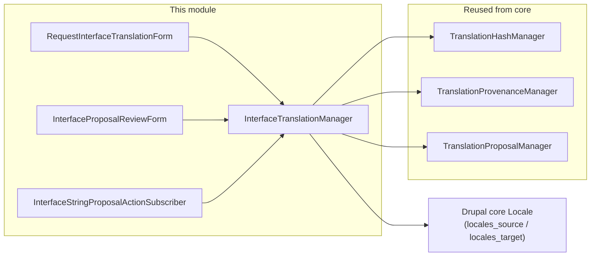
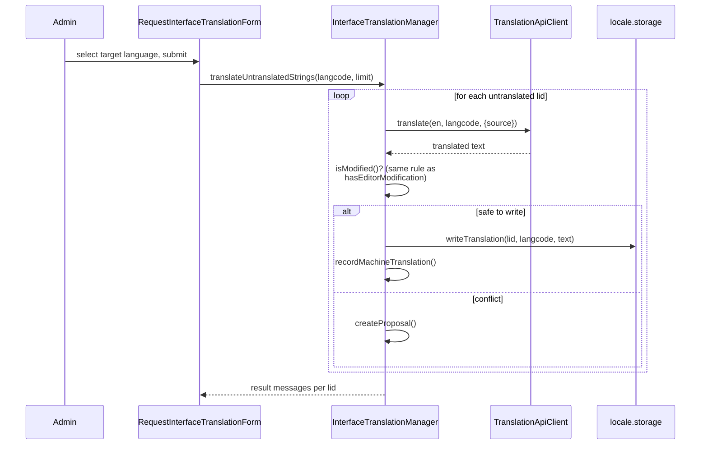

# Interface String Translation

Covers [`tmgmt_external_translation_interface`](../web/modules/custom/tmgmt_external_translation_interface), which extends the same provenance/conflict/proposal engine to Drupal's **interface strings** — the UI text translated through core's Locale system at `/admin/config/regional/translate`, entirely separate from content entities.

## Why this is a separate, smaller module

Interface strings (`locales_source`/`locales_target`, Drupal core's Locale tables) aren't content entities at all — there's no `ContentEntityInterface` to hang a `TranslationFieldContext` off of the normal way, no TMGMT job item, and no `content_translation` involvement. This module reuses only the **field-slot-level** bookkeeping services from the core module (`TranslationHashManager`, `TranslationProvenanceManager`, `TranslationProposalManager`) — all of which only deal in `TranslationFieldContext` and arbitrary strings, not entities — while implementing its own read/write logic against `locale.storage` directly. The core module's entity-coupled services (`TranslationConflictDetector`, `ContentEntitySource`) are not reused, because there's no entity to check conflicts against.

A pseudo entity type, the literal string `'interface_string'`, stands in for `target_entity_type` in every `TranslationFieldContext` this module creates — `target_entity_id` is the string's `lid` (locale id), and `field_name` is always `'translation'`. This is what lets the generic proposal dashboard and the `translation_provenance`/`translation_proposal` tables handle interface strings uniformly alongside content fields and layout labels, without those tables needing a real entity type to exist.

## Translation flow

Unlike content, this module has **no async submit/poll/complete split** — `translateOne()` calls `TranslationApiClientInterface::translate()` (the synchronous convenience method) directly, since there's no TMGMT job item or entity save lifecycle to defer against. This was a deliberate scoping decision, not an oversight: adding a fake poll loop against nothing would just be complexity with no benefit here.

Two entry points:
- **`translateUntranslatedStrings($targetLangcode, $limit)`** — finds strings with no existing translation at all (a `LEFT JOIN` against `locales_target` filtered to `NULL`) and translates up to `$limit` of them. Reachable at `/admin/config/regional/translate/request-machine-translation`.
- **`retranslateString($lid, $targetLangcode)`** — re-translates one specific already-translated string (e.g. because the English source changed). Same conflict logic applies: safe to overwrite only if unmodified since the last machine translation.

Both are **manually triggered only** — a deliberate POC scoping decision; there is no automatic "translate every new string as it appears" hook.

## Editor corrections are protected the same way

[`hook_form_locale_translate_edit_form_alter()`](../web/modules/custom/tmgmt_external_translation_interface/tmgmt_external_translation_interface.module) appends a submit handler to Drupal's own interface translation edit form (the normal `/admin/config/regional/translate` UI editors already use) that classifies every saved string exactly the way content field saves are classified: unchanged relative to the last recorded baseline is a no-op; matching the last provider output is an implicit approval; anything else is recorded as an editor correction (`ORIGIN_EDITOR_MODIFIED`) and protected from future silent overwrite.

## Proposal resolution

Interface-string proposals go through the same [`ProposalActionEvent`](architecture.md#event-catalog) mechanism as Layout Builder labels: [`InterfaceStringProposalActionSubscriber`](../web/modules/custom/tmgmt_external_translation_interface/src/EventSubscriber/InterfaceStringProposalActionSubscriber.php) claims any proposal whose `target_entity_type === 'interface_string'` and resolves it via `InterfaceTranslationManager::acceptStringProposal()` / `rejectStringProposal()` / `editStringProposal()` — writing directly into `locale.storage`, never through `TranslationProposalManager`'s generic entity-field path (there is no entity to write to).

Two review surfaces exist:
- **Per-language:** [`InterfaceProposalReviewForm`](../web/modules/custom/tmgmt_external_translation_interface/src/Form/InterfaceProposalReviewForm.php) at `/admin/config/regional/translate/proposals/{langcode}` — this module's own dedicated page, predating the central dashboard.
- **Site-wide:** the central [`ProposalDashboardForm`](../web/modules/custom/tmgmt_external_translation/src/Form/ProposalDashboardForm.php) at `/admin/content/translation-proposals` (core module) also lists interface-string proposals alongside content and layout-label ones, tagged with an "Interface string" badge — both surfaces resolve through the same `resolveProposal()` entry point, so accepting/rejecting from either produces identical results.

## Permissions

Reuses the core module's permissions exactly:

| Permission | Used for |
|---|---|
| `manage translation providers` | Access to the "Request machine translation" form. |
| `accept translation proposals` + `reject translation proposals` | Access to either proposal review surface. |

No interface-string-specific permissions exist — see [developer-guide.md](developer-guide.md#permissions-reference) for the full permission list across all three modules.

## See also

- [architecture.md](architecture.md#the-conflict--proposal-model) — the conflict/proposal decision logic this module's `isModified()` mirrors exactly.
- [editorial-guide.md](editorial-guide.md) — using this from an editor's perspective.
