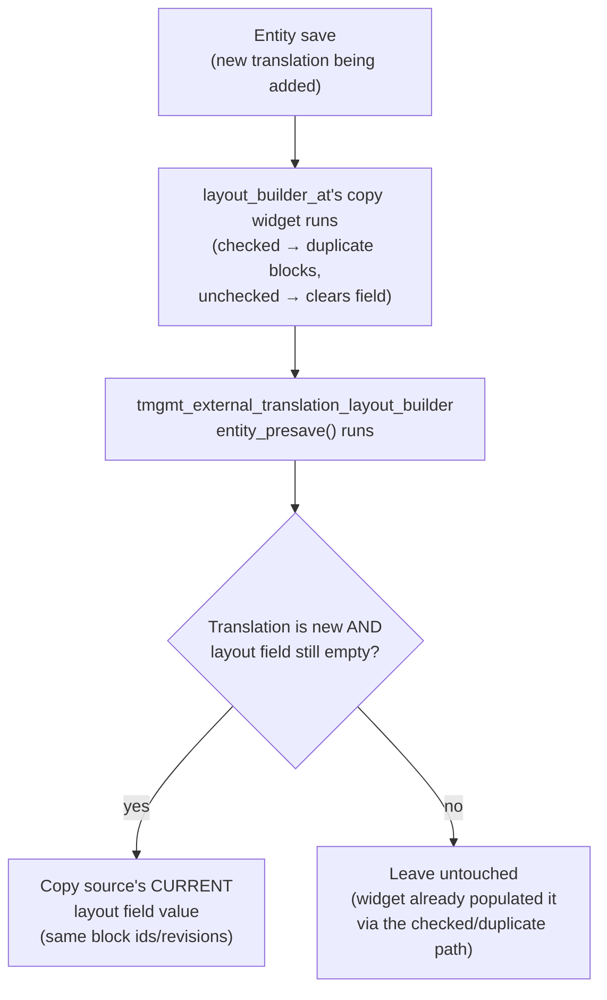
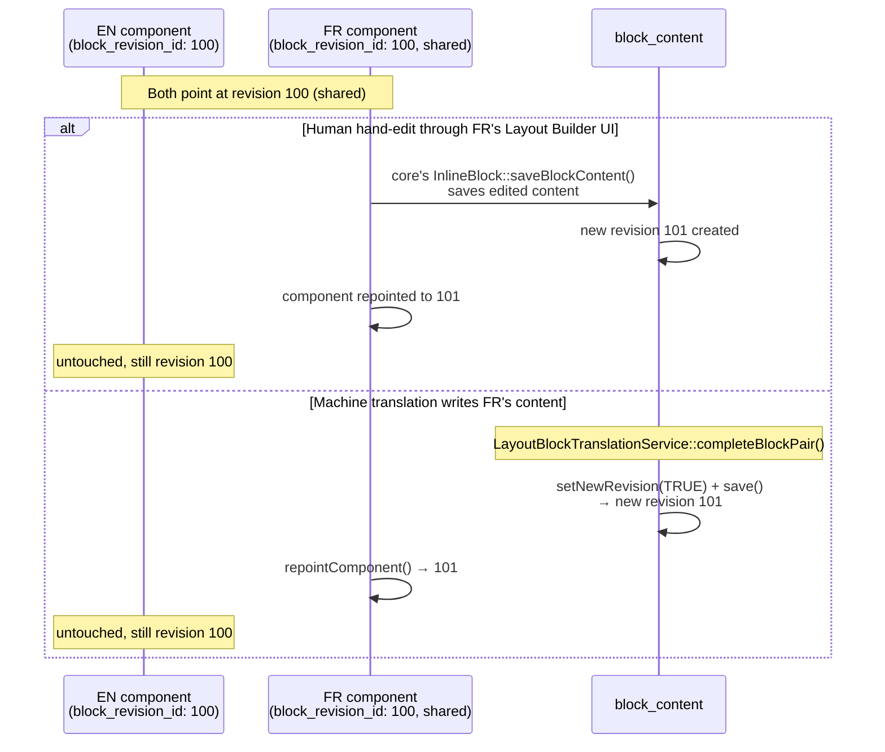
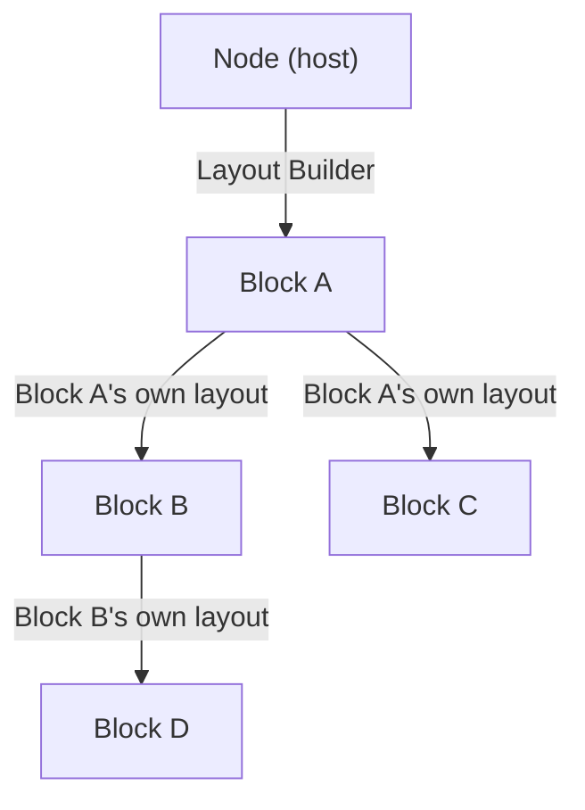
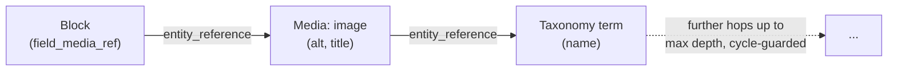
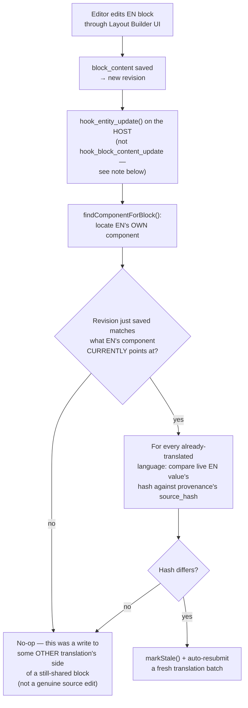

# Layout Builder Integration — Deep Dive

Covers [`tmgmt_external_translation_layout_builder`](../web/modules/custom/tmgmt_external_translation_layout_builder), the largest and most architecturally novel of the three modules. Read [architecture.md](architecture.md) first for the shared conflict/proposal/moderation/async machinery this module reuses rather than reinvents.

## Why Layout Builder needs special handling at all

An ordinary translatable field is a value directly on the entity being translated — Drupal's `content_translation` API already knows how to store and resolve a separate value per language. A Layout Builder **inline block** is different: it's a full, separate `block_content` entity, referenced from the host page's layout configuration by `block_revision_id`, not a field value on the host entity itself.

The core constraint that shapes every design decision in this module: **Layout Builder's own inline-block edit form is not translation-context aware.** [`InlineBlock::getEntity()`](https://git.drupalcode.org/project/drupal/-/blob/10.6.x/core/modules/layout_builder/src/Plugin/Block/InlineBlock.php) resolves a block purely by `loadRevision($block_revision_id)` — there is no language negotiation in that lookup at all. If a block were made into a genuinely multi-translation Drupal entity (i.e. `hasTranslation('fr') === TRUE` the way a node can), editing it through Layout Builder's own UI would silently edit whichever language's version core happens to load by *revision id*, not by the language actually being viewed — a real, silent data-corruption risk, confirmed empirically during development (see [Architecture history](#design-history-why-not-just-make-blocks-translatable) below).

**Resolution: `block_content` entities stay single-langcode forever in this system.** A block is never given a genuine Drupal translation. Instead, "the French version" and "the English version" of a block's content are two different **revisions of the same entity id**, and which revision is shown in which language is determined entirely by which revision the *host page's own Layout Builder component* points at for that language's translation. This single decision is the foundation everything below builds on.

## Shared-by-default

A brand-new translation's Layout Builder layout starts out referencing the **exact same** block ids/revisions as its source language — not a copy, not empty.

### Why this needed custom code

Drupal core's `ContentTranslationController::prepareTranslation()` pre-fills every translatable field with the source value when a translation is added — but confirmed empirically (`drush php:eval`, not assumed) that this does **not** actually happen for `layout_builder__layout`: the field remains empty immediately after `addTranslation()` regardless of the values array passed in. Separately, `layout_builder_at`'s own "Copy blocks into translation" checkbox, left **unchecked**, actively clears the field (`LayoutBuilderCopyWidget::extractFormValues()`'s unchecked branch calls `$items->setValue(NULL)` — confirmed via direct source read). So without intervention, a new translation's Layout Builder content is *always* empty, whichever way the checkbox is left.

[`tmgmt_external_translation_layout_builder_entity_presave()`](../web/modules/custom/tmgmt_external_translation_layout_builder/tmgmt_external_translation_layout_builder.module) runs after the widget either way, and for any translation that `isNewTranslation()` and still has an empty layout field, populates it from `$entity->getUntranslated()`'s **current** value:

The checkbox remains available as an opt-in eager-duplication escape hatch for an editor who explicitly wants a fully independent layout from day one — this hook only fills the gap the *unchecked* path (and plain "Add translation" with no Layout Builder involvement at all) would otherwise leave.

**Practical consequence:** a block added to the English page *after* French was already translated is automatically visible in French too — there's nothing to "sync," because both languages are looking at the same underlying block until something diverges it.

## Fork-on-write

A shared block only diverges — gets its own distinct content per language — the moment something actually writes different content for one language. There are exactly two paths that can do this, and both use the same mechanism: **a new revision of the same block id**, with only the *editing* translation's own layout component repointed to it.

The explicit `setNewRevision(TRUE)` call in [`completeBlockPair()`](../web/modules/custom/tmgmt_external_translation_layout_builder/src/Layout/LayoutBlockTranslationService.php) is not optional — `block_content`'s `isNewRevision()` defaults to `FALSE`. Without it, a write to a still-shared block would silently overwrite the *same* revision the English component also points at, corrupting what English renders (confirmed as a real bug during development — English briefly showed translated/duplicated text before this was caught).

### Conflict detection for blocks specifically

Ordinary fields use the generic, translation-aware `hasEditorModification()` (reads the live value via `$entity->getTranslation($langcode)`). Blocks can't use that path — since a block never has a real Drupal translation, `hasTranslation('fr')` is always `FALSE`, so the generic reader would find nothing to compare and silently disable conflict protection. Block writes instead use `hasEditorModificationForValue()`, passing the target block's live value read directly off the currently-loaded entity — same underlying rule (byte-identical to source, or matching last provider hash, is safe to overwrite; anything else becomes a proposal), just sourced differently. Component labels ([below](#component-labels)) already used this explicit-value variant from the start, since labels were never a generic entity field to begin with.

## Component labels

The optional heading shown above a block ("Display title" checked) is **config on the host entity's own layout field** — not a field on the `block_content` entity at all. It's translated through a separate code path ([`completeComponentLabel()`](../web/modules/custom/tmgmt_external_translation_layout_builder/src/Layout/LayoutBlockTranslationService.php)) with its own conflict check, and — because it isn't a real entity field — its proposals can't go through `TranslationProposalManager`'s generic `writeToEntity()`. Instead, [`ProposalActionEvent`](architecture.md#event-catalog) lets [`LayoutLabelProposalActionSubscriber`](../web/modules/custom/tmgmt_external_translation_layout_builder/src/EventSubscriber/LayoutLabelProposalActionSubscriber.php) claim any proposal where `field_name === 'layout_component_label'` and resolve it via [`LayoutLabelProposalHandler`](../web/modules/custom/tmgmt_external_translation_layout_builder/src/Layout/LayoutLabelProposalHandler.php), which writes through `LayoutEntityCollector::setComponentLabel()` directly.

Labels never fork or share identity the way block content does — label storage is already independent per host translation from day one (it's part of that translation's own layout field value), so there's no "still shared" state to reason about for labels at all.

## Nested inline blocks

A block can itself have a Layout Builder layout field containing further inline blocks — which can themselves have further children, recursively (spec: Inline Block → Inline Block → Inline Block). Since `layout_builder_at` forces `layout_builder__layout` translatable entity-type-agnostically, this "just works" once `block_content` has the field.

[`completeNestedBlockPairs()`](../web/modules/custom/tmgmt_external_translation_layout_builder/src/Layout/LayoutBlockTranslationService.php) recurses down this tree, reusing `completeBlockPair()`/`completeComponentLabel()` **as-is** at every level — both already operate on a generic `ContentEntityInterface $targetHostTranslation`, so a block-as-host behaves identically to a node-as-host from their point of view. Bounded by a configurable max depth (State API key `tmgmt_external_translation_layout_builder.block_nesting_max_depth`, default 5), with cycle protection via a `$visitedBlockIds` set.

**The one thing the top-level call site doesn't need but nested completion does:** after a grandchild pass advances a child block's own revision, the *parent's* pointer to that child must be re-repointed, or the chain breaks one level up. This is handled by an explicit re-repoint call after every `completeNestedBlockPairs()` return, both at the top-level call site and inside the recursive method's own loop (for grandparent→parent propagation) — a real bug caught and fixed during development (only the top-level child translated correctly in an early 3-level test; children of children were submitted but never written back until this was added).

## Referenced entity translation

A block's own `entity_reference` fields (e.g. to a Media item) are followed to translate the *referenced* entity's trackable properties — a Media item's `alt`/`title`, for instance — recursively, up to a configurable depth (State API key `tmgmt_external_translation_layout_builder.reference_max_depth`, default 5), with cycle protection.

This is a genuinely different mechanism from block-content translation: a Media item **is** a real, natively-translatable Drupal entity (unlike blocks), so this path uses the generic entity-translation-aware machinery — [`TranslationEntityWriter::write()`](../web/modules/custom/tmgmt_external_translation/src/Translation/TranslationEntityWriter.php), which creates the target-language translation via `addTranslation()` if it doesn't exist yet, then writes into it — the same as ordinary content field translation, just reached from inside a block's reference field instead of from a TMGMT job item directly.

**Only alt/title are ever translated on an image, never the file itself.** Confirmed directly against this project's DB: `target_id` (which physical file a Media item's image field points at) is byte-identical across every language's translation, because [`tmgmt_external_translation_trackable_field_properties()`](../web/modules/custom/tmgmt_external_translation/tmgmt_external_translation.module) explicitly limits the `image` field type to `['alt', 'title']`. The image file is **reused**, never duplicated, across languages.

### Why `block_content` is explicitly excluded from this path

`content_translation` happens to be enabled for `block_content:basic` on this site — required by `layout_builder_at`'s own translatable-field mechanism, entirely unrelated to this decision. Without an explicit exclusion, a plain `entity_reference` field on one block pointing at *another* block would be wrongly treated as "genuinely translatable," creating a real multi-langcode Drupal translation of the referenced block — directly violating the "blocks stay single-langcode forever" rule this whole module depends on. [`isGenericallyTranslatableTarget()`](../web/modules/custom/tmgmt_external_translation_layout_builder/src/Layout/LayoutBlockTranslationService.php) hard-excludes `block_content` from this path; confirmed as a real bug found and fixed during development (a block referenced only via a plain field silently gained `hasTranslation('fr') === TRUE`, which would have corrupted manual editing had that same block ever been placed via Layout Builder elsewhere).

A block referenced via `entity_reference` is therefore **not** covered by any translation path in this module — a plain `entity_reference` field only stores a `target_id`, which always resolves to whatever the referenced block's current *default* revision is, with no per-translation pin the way a Layout Builder component's own `block_revision_id` config provides. Supporting this correctly would need `entity_reference_revisions` (which *does* pin a specific revision) instead of plain `entity_reference` — a distinct, unbuilt feature.

## Staleness detection

Editing the English source block's own content automatically marks every already-translated language's copy stale and resubmits a fresh translation batch — no manual "re-request" action needed from the editor.

### Two bugs this guard exists to prevent

1. **Wrong trigger point.** `hook_block_content_update()` fires *inside* the host's own presave phase — before the host's component pointer has actually been updated in the database — so a freshly-loaded lookup at that point always sees the *stale, pre-edit* pointer, and staleness never triggers on a real edit. The reliable trigger is `hook_entity_update()` on the **host** ([`tmgmt_external_translation_layout_builder_entity_update()`](../web/modules/custom/tmgmt_external_translation_layout_builder/tmgmt_external_translation_layout_builder.module)), which only fires after the host's own save has actually committed.
2. **Infinite retranslation cascade.** Under the shared-by-default model, the *same* block id can appear in multiple translations' layouts indefinitely — including our own writes to the target side, which share that id while unforked. A langcode-only guard isn't enough: `findComponentForBlock()` can legitimately return EN as a match even when the save that just happened was actually a *target-side* write. Without a revision check too, the hook would treat our own MT write as a new "source change" and resubmit — confirmed as a severe bug during development (traced to 40+ chained re-translation batches in a single run before hitting the polling loop's pass cap). The fix: only proceed if the just-saved revision matches what EN's component **currently** points at — EN's own pointer only ever advances on a genuine EN re-save, never as a side effect of a write to another translation.

**Known, accepted limitation:** because this hook fires nested inside the host's own presave phase, the very save that performs a genuine EN edit can, in rare cases, not yet see its own component-pointer update landed in the DB on that exact save, and miss auto-triggering. The edit itself is never lost — only the auto-trigger can lag until a later, unrelated save of the same block re-fires the hook with now-caught-up state. Not a correctness issue, just eventually-consistent.

## Moderation gating for blocks

Every write that repoints a layout component or sets a label — `LayoutEntityCollector::repointComponent()` and `setComponentLabel()` — calls [`ModerationGate::gateIfPublished()`](../web/modules/custom/tmgmt_external_translation/src/Translation/ModerationGate.php) on the **host** translation before saving, exactly the same rule as ordinary field translation (see [architecture.md](architecture.md#moderation-gating)). This covers a block that plays a dual role correctly: a block placed independently on Node A (via Layout Builder) and *also* referenced from a block on Node B (via a plain `entity_reference` field, which — per the exclusion above — this module ignores entirely) has its moderation state governed solely by whichever host's own layout component points at it; the two roles are fully isolated from each other by construction of that same exclusion.

## Identity-aware block pairing

[`LayoutBlockMapper::mapBlocks()`](../web/modules/custom/tmgmt_external_translation_layout_builder/src/Layout/LayoutBlockMapper.php) pairs a source translation's blocks with a target translation's blocks for translation purposes. Under the shared model, matching source and target blocks that reference the **same id** is now the *common* case, not an error — checked first. Anything left unmatched (already-forked pairs, or genuinely independent per-language additions) falls back to positional pairing (section delta, then component weight) among the remainder only.

**Known, documented limitation:** among already-forked/independent components, if an editor reorders them independently in one language but not the other, positional pairing among the remainder can still mismatch. Fixing this would require `layout_builder_at` to expose an explicit source-to-target block mapping, which it does not currently do.

## Design history: why not just make blocks translatable?

An earlier design direction (briefly considered, not shipped) was to give `block_content` genuine multi-translation support — an editor-facing model that might feel more natural. It was rejected specifically because of the `InlineBlock::getEntity()` constraint described at the top of this document: Layout Builder's own inline-block edit form resolves by revision id, not by language, so a real translation would let a user unknowingly edit the wrong language's content through the normal Layout Builder editing UI. Keeping blocks single-langcode-forever and modeling "the French version" as a revision, resolved entirely through the host page's own component config, sidesteps this core-level gap entirely rather than working around it per call site.

## See also

- [architecture.md](architecture.md) — the shared conflict/proposal/moderation/async machinery this module builds on.
- [developer-guide.md](developer-guide.md) — `LayoutEntityCollector`/`LayoutBlockMapper`/`LayoutBlockTranslationService` API reference, State API tunables.
- [editorial-guide.md](editorial-guide.md) — what shared vs. forked blocks look like from an editor's perspective.
- [deployment-and-migration.md](deployment-and-migration.md) — what happens to a site's *existing* Layout Builder content when this module is installed.
